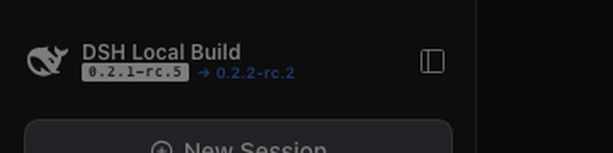
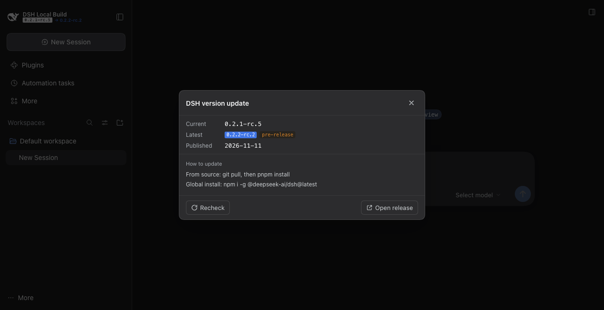

# dsh-version-check

在 dsh Web 侧栏的 logo 旁边（现在显示「DSH 本地构建 / 版本号」的位置）标出官方有没有发新版本。
查版本是只读的；点了升级才会在你机器上跑 git / pnpm（或 npm）。

## 显示成什么样

品牌名那块还是两行：第一行「DSH 本地构建」，第二行是版本状态。

| 状态 | 显示 |
| --- | --- |
| 有新版本 | `0.2.1-rc.5 → 0.2.2-rc.2`，箭头和新版本号是品牌蓝 |
| 已最新 | `0.2.1-rc.5 已最新`，灰色 |
| 检查中 | `0.2.1-rc.5 检查中`，灰色 |
| 查不到 | `0.2.1-rc.5 检查失败`，琥珀色，不冒充已最新 |
| 读不到本机版本 | 只显示「读不到本地版本」 |





点这一块弹出小面板：当前版本、官方最新（带「预发布」标签）、发布时间、发布页链接、升级命令、复制命令、升级按钮、重新检查。
点它不会触发旁边的「新建会话」按钮。

官方构建（`ui-brand-official`）会先占住品牌名槽位，这时插件自动退到侧栏底部的列表槽位，内容一样，只是位置不同。

## 升级

面板下方给出「更新方式」，内容按本机安装形态自动选：

| 安装形态 | 怎么认 | 升级动作 |
| --- | --- | --- |
| 源码仓库 | 从 dsh 入口往上能找到含 `.git` 的 `@deepseek-ai/dsh-root` | `git fetch` → `git checkout dsh-v<版本>` → `pnpm install --frozen-lockfile` → `pnpm run build` |
| 全局 npm 包 | 同上但找不到 `.git` | `npm i -g @deepseek-ai/dsh@<版本>` |

- 「复制命令」把上面这条命令放进剪贴板，自己粘到终端跑，插件什么都不动。
- 「升级到 x」先要再点一次确认，然后全自动跑：
  1. 先写一个 `building` 锁，再把当前 dsh 停掉（SIGTERM，20 秒不退就 SIGKILL）；
  2. `git fetch` / `checkout` / `pnpm install` / `pnpm run build`，每一步的 phase 和日志都写在状态文件里；
  3. 构建成功就把 dsh 起回来，再调 `start.sh --refresh` 刷新你原来那个标签页。页面中途会断开几分钟，不用管；
  4. 构建失败会先回退到升级前的分支重新构建，然后照样把 dsh 起回来。
- 构建期间 `./start.sh` 会看到 `building` 锁，直接拒绝启动，防止中途插进来一个版本对不上的实例。
- 源码版要求检出目录里有 `start.sh`（本机这个启动脚本）才会自动重启；全局 npm 安装或者没有 `start.sh` 时只做升级，弹窗会写清楚要手动重启。
- 源码版升级完是 detached HEAD（HEAD 停在新 tag 上）。要留住这个版本：`git switch -c upgrade/v0.2.2-rc.2`。要回原来的分支：`git checkout upgrade/<原分支> && pnpm install --frozen-lockfile && pnpm run build`（失败时弹窗也会把这条命令写出来）。
- 仓库有未提交的改动（不含未跟踪文件）时不允许自动升级，避免覆盖你的工作。
- 同一时间只跑一个升级任务；状态写在 `$DSH_HOME/state/dsh-version-check/upgrade/`（`phase`、`done`、`output.log`、`building`），进程重启也读得到。

## 判断依据

- 本机版本：从 dsh 启动入口读 `@deepseek-ai/dsh` 的 `package.json` 版本，源码运行和 npm 安装都能读到。
- 官方版本：读 GitHub Releases（`deepseek-ai/deepseek-harness`），只认 `dsh-v*` 的 tag，跳过草稿。
- 比大小按 semver：`0.2.2-rc.2 > 0.2.1-rc.5`，`0.2.1-rc.5 < 0.2.1`，`alpha < rc`，数字段按数值比。
- 官方最新是预发布版本时照样提示，但标出「预发布」，让你自己决定跟不跟。
- 网络失败、限流、没有 Release，都显示「检查失败」，不会显示「已最新」。

## 安装

```bash
dsh plugin --profile web add "file:/Users/leeo/Documents/workspace-ds/plugin/dsh-version-check"
```

装完重启 `dsh web`（或桌面端）。

## 环境变量

| 变量 | 作用 |
| --- | --- |
| `DSH_RELEASE_REPO` | 换官方仓库，默认 `deepseek-ai/deepseek-harness` |
| `GITHUB_TOKEN` | 提高 GitHub API 配额（匿名每小时 60 次）。也会读 dsh 凭据服务里的 `GITHUB_TOKEN` |
| `DSH_VERSION_CHECK_STATE_DIR` | 换升级状态目录（测试用），默认 `$DSH_HOME/state/dsh-version-check`，`DSH_HOME` 没设就是 `~/.dsh/state/dsh-version-check` |

## 开销

- 结果缓存 30 分钟，界面每 30 分钟查一次；升级计划里的 `git status` 结果缓存 60 秒。
- 一次检查 1 个 GitHub 请求，匿名配额够用；设 `GITHUB_TOKEN` 更稳。
- 升级期间界面每 1.2 秒读一次本地状态文件，不碰网络。

## 接口

| 方法 | 路径 | 说明 |
| --- | --- | --- |
| GET | `/plugins/dsh-version-check/status[?refresh=1]` | 当前版本、最新版本、状态、错误、升级计划 |
| GET | `/plugins/dsh-version-check/upgrade` | 当前升级任务的 phase / 日志尾巴 / 结果 |
| POST | `/plugins/dsh-version-check/upgrade` | 启动升级，body `{"version":"...","tag":"...","confirm":true}` |

POST 走 dsh 连接服务的信任与鉴权闸门；必须 `confirm: true`，`tag` 必须和 `version` 对得上。

## 开发

```bash
node test-host.mjs    # semver、本机版本、安装形态、升级脚本、升级路由的拒绝路径（会访问 GitHub）
node test-client.mjs  # 品牌槽位注册、退路、样式注入、弹窗渲染（真 React SSR）
```

`index.js` 是启动壳：host.js 加载失败只停用插件，不会把 dsh 启动拖死。
改了源码之后跑 `bash scripts/sync.sh` 同步到本机 profile 的那份拷贝，再重启 dsh。

## License

MIT
